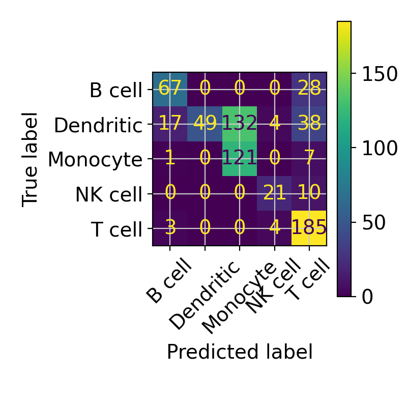
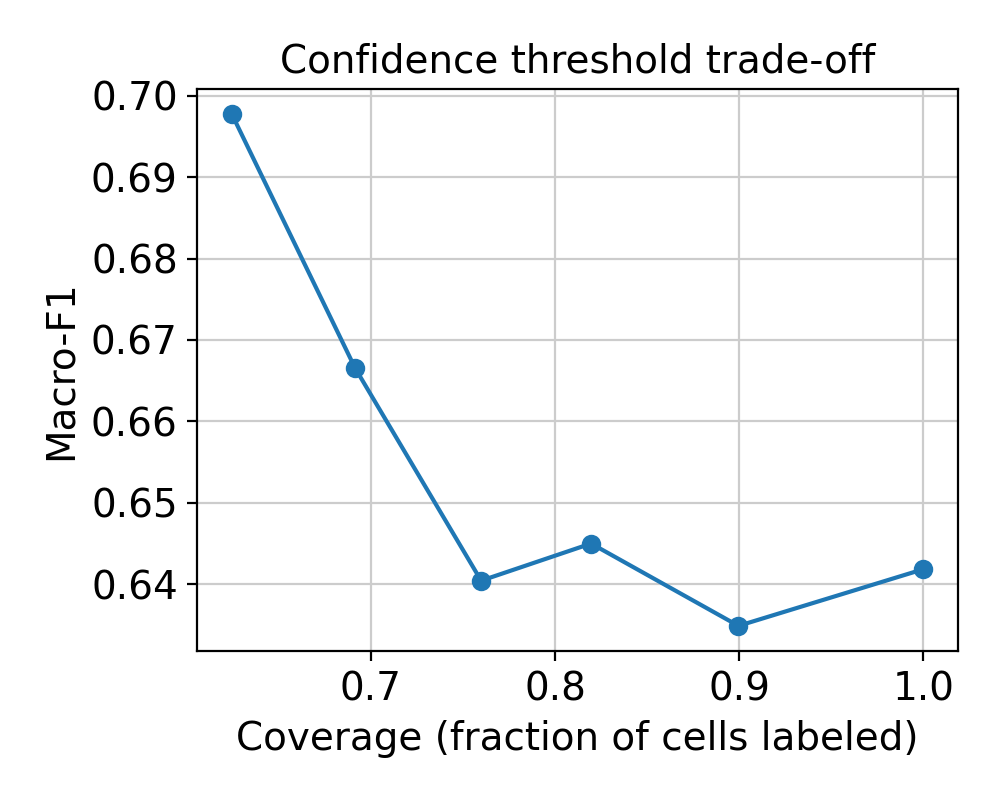

# Single-Cell Cell Type Annotator (PBMC)

Supervised cell-type annotation benchmarked across two independent PBMC datasets,
with confidence-based rejection and biological validation.

**Live demo:** https://sc-cell-annotator.streamlit.app/

## Problem
Manual cell-type annotation in single-cell RNA-seq is slow and inconsistent between labs.
This project tests how well automated classifiers generalize to a dataset they have never seen.

## Results

| Model | Macro-F1 within pbmc3k | Macro-F1 train pbmc3k, test pbmc68k |
|---|---|---|
| LogReg | 0.987 | 0.642 |
| LinearSVC | 0.956 | 0.560 |
| RandomForest | 0.906 | 0.581 |
| MLP | 0.918 | 0.543 |

Logistic regression dropped from 0.987 within-dataset to 0.642 on the independent dataset,
which shows the cost of dataset shift. Simpler linear models generalized better than
RandomForest and MLP.

The main failure was dendritic cells: precision 1.00 but recall only 0.20. Monocyte had
the opposite pattern (recall 0.94, precision 0.48), suggesting dendritic cells were
often labeled as monocytes (shared myeloid genes, and only 37 dendritic training cells).

Confidence threshold results: `figures/threshold.csv`
Top-weighted genes per cell type: `figures/top_genes.csv`

## Method
Train on pbmc3k, test on pbmc68k_reduced. Labels merged into coarse categories
(T, B, NK, Monocyte, Dendritic, Megakaryocyte). Shared genes z-scored per dataset.
Metric: macro-F1.

## Run locally
    pip install -r requirements.txt
    streamlit run app/app.py

## Limitations
- Coarse labels; T cell subtypes are merged
- pbmc68k_reduced has only 765 genes, so few genes are shared
- No megakaryocytes in the test set
- Within-dataset labels come from clustering the same data, so within-dataset scores are optimistic
- PBMC only; not for clinical use

## Future work
Larger CELLxGENE training sets, Harmony/scVI integration, finer cell-type labels.
